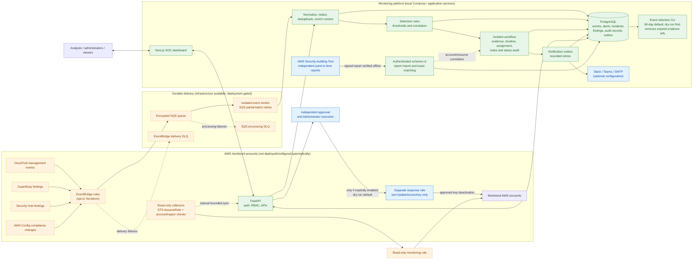

# AWS Cloud Security Monitoring Platform

Continuous AWS threat monitoring and incident response, designed to complement—not replace—the
independent [AWS Security Auditing Tool](https://github.com/joeabur/AWS-security-auditing-tool).

## Responsibilities

- **AWS Security Auditing Tool:** point-in-time, read-only posture assessment against its 41 controls;
  produces evidence-backed reports.
- **This platform:** continuous event ingestion, threat detections, alerting, and incident workflows.
  It imports auditor reports and correlates exact account/resource matches with ongoing activity.

The auditor's current JSON report uses `schema_version: 1`, with account and region context plus
`findings[]` entries containing `finding_id`, `control_id`, `resource_id`, `resource_type`,
`severity`, `status`, `message`, `evidence`, `observed_at`, and `remediation`. The importer validates
that schema, retains a canonical report fingerprint, original finding identifiers, and assessment
timestamps, and maps exact resource IDs without changing or calling the auditor. Masked account IDs
are preserved and are never guessed or correlated to a full AWS account. No auditor dependency or
API is required for this platform.
The report importer does not verify the auditor's optional signature manifest; verify signed files
with the auditor's published verification workflow and trusted public key before upload.

## Architecture and implementation plan

The intended production data path is **AWS services → EventBridge → SQS (+ DLQ) → isolated event
worker → normalization/detection/correlation → PostgreSQL → FastAPI → dashboard/notifications**.
SQS buffers bursts and permits retries; a dead-letter queue preserves repeatedly failing messages.
FastAPI serves the analyst UI and APIs, not the AWS event polling loop. AWS access will use the
standard boto3 credential chain locally and STS-assumed, read-only roles for monitored accounts.
Response actions are opt-in and use a separate narrowly-scoped role.

See the [verified capability assessment and prioritized modernization roadmap](docs/platform-assessment.md)
for the service coverage matrix, competitive comparison, security/reliability gaps, and proposed next
steps. The current product is security-event monitoring; customer infrastructure metrics, APM, and
cost monitoring are not yet implemented.

## Architecture and workflow diagram

The diagram shows both the implemented application paths and the AWS deployment components that
remain opt-in. AWS resources are **not deployed by this repository**; the production Terraform
environment and EventBridge/SQS module require a reviewed deployment and source-account setup.



**End-to-end flow:** AWS service events can be routed through EventBridge and SQS into an isolated
worker; authenticated API ingestion and bounded AWS finding sync are also available. The ingestion
pipeline normalizes and deduplicates events, evaluates versioned rules, persists evidence and alerts,
and groups related alerts into incidents. Analysts review incidents in the dashboard and may record
notes, assignments, and status changes. Eligible alerts enter a deduplicated notification outbox.
Auditor reports are imported separately and correlated only on exact account/resource matches.
Response actions require incident evidence and independent approval; live access-key deactivation
uses the separate response role and remains disabled by default.

| Phase | Deliverable |
|---|---|
| 1 — Foundation (complete) | FastAPI service, PostgreSQL schema/migration, role-based token authentication, health endpoint, Compose, live health UI |
| 2 — Ingestion (complete) | CloudTrail normalization, durable event persistence/API, idempotency, SQS partial-batch worker, synthetic generator, opt-in EventBridge/SQS Terraform module |
| 3 — Detection (complete) | 18 initial rules plus high-severity Security Hub coverage, including monitoring disablement, MFA device removal, and public EBS snapshot sharing; thresholds, persisted deduplicated alerts, explicit risk-score basis, and rule testing |
| 4 — Incidents (complete) | Alert grouping, evidence and event timeline, incident lifecycle, assignment, notes, audit trail |
| 5 — AWS integrations (implemented, deployment gated) | STS account health/region discovery; bounded GuardDuty, Security Hub, and Config sync APIs; EventBridge/SQS routing; no customer workload metrics or inventory |
| 6 — Operations UI and notifications (complete) | Real-event metrics and filters, incident investigation UI, Slack/Teams/email outbox and delivery health |
| 7 — Auditor integration (complete) | Schema-v1 JSON report import, audit history, and resource correlation with incidents/dashboard |
| 8 — Controlled response (complete, limited) | Detection-only by default; independently approved dry-run/live IAM access-key disable playbook with separate role and audit trail |
| 9 — Production readiness (local/CI complete; deployment gated) | CI checks, non-root images, controlled migrations, dependency updates, and operations/readiness guide |

### MVP boundary

The MVP is CloudTrail event ingestion, normalization, detection and incident evidence, with bounded,
manual GuardDuty, Security Hub, and Config collection. Notifications and auditor-report correlation build
on the stable ingestion and incident contracts; response automation remains deferred. Phases 1–3
deliberately contain no direct AWS polling, live AWS connection, or mock dashboard counts. The
initial UI reports actual API/database health and the synthetic generator creates clearly marked
local records.

## Milestones and acceptance criteria

### Phase 1 — Foundation (complete)

- [x] Local application, PostgreSQL migration, authentication, role checks, service health, and live
  health dashboard.

### Phase 2 — Event ingestion (complete)

- [x] Normalize CloudTrail records and EventBridge envelopes; normalize timestamps to UTC and reject
  ambiguous timestamps or missing account/event identifiers.
- [x] Persist selected normalized fields and a filtered detail subset, redact obvious secret-bearing
  keys, and deduplicate by account, region, and CloudTrail event ID.
- [x] Provide authenticated ingest/read APIs with account, region, name, and time filters plus
  pagination; only analysts and administrators may ingest.
- [x] Add an SQS Lambda handler that reports per-message failures for retry, and provide separate
  delivery and processing DLQs in opt-in Terraform.
- [x] Generate local synthetic CloudTrail records with an explicit synthetic marker.
- [x] Routine validation does not require AWS credentials or paid AWS services.

### Phase 3 — Detection engineering (complete)

- [x] Versioned detection library covers the initial 15 AWS activity and exposure scenarios, with
  MITRE mappings where applicable; high/critical Security Hub findings also generate alerts.
- [x] Evaluate new events during ingestion; thresholded failures correlate within documented
  windows and by source/principal where appropriate.
- [x] Persist deduplicated alerts with evidence-event references, relative risk score explanation,
  recommended investigation steps, and response guidance.
- [x] Provide authenticated rule inventory, event test endpoint, alert search/filter/pagination, and
  alert evidence endpoint.
- [x] Keep allowlist-dependent rules disabled until their required environment configuration exists.
- [x] Test expected positive/negative scenarios and ensure rule tests do not persist synthetic events.

Scores are rule-defined prioritization values from 0–100, **not probabilities or definitive risk**.
Rule severity and score basis are visible on every alert; score values can be adjusted in the
versioned rule definitions. Rule definitions live in
[`backend/app/detections/rules.py`](./backend/app/detections/rules.py); updates are reviewed and
versioned as code.

### Phase 4 — Incident management (complete)

- [x] Persist incidents and alert associations; related active alerts are grouped by account, region,
  and principal, resource, or source IP when observed within 24 hours. Signals without a shared
  principal, resource, or source IP are kept distinct by rule and alert key.
- [x] Incident severity/risk reflects the highest linked alert; scores remain relative rule-defined
  priorities, not a probability.
- [x] Support `new`, `acknowledged`, `investigating`, `contained`, `resolved`, and `false_positive`
  lifecycle states, with validated transitions and explicit reopening after new evidence.
- [x] Provide paginated/searchable incident listing, evidence and event timelines, analyst
  assignment, append-only investigation notes, and an actor-attributed audit trail.
- [x] Require Administrator or Security Analyst authorization for incident mutations; viewers retain
  read-only access. Every analyst mutation is recorded in the incident audit trail.

### Phase 5 — AWS integration code (implemented; deployment and scheduled collection gated)

- [x] Configure multiple monitored accounts without storing AWS credentials; role assumption uses
  temporary STS credentials, optional external IDs, and the local AWS credential chain.
- [x] Add STS identity validation, enabled-region discovery, and bounded GuardDuty finding sync with
  SDK retries, pagination, account/region validation, and idempotent event ingestion.
- [x] Synchronize bounded Security Hub findings and AWS Config compliant/non-compliant evaluations
  into the normalized event pipeline; high/critical Security Hub and relevant Config drift generate
  alerts.
- [x] Persist deduplicated GuardDuty, Security Hub, and Config finding snapshots; newer provider
  timestamps update status without older updates overwriting them.
- [x] Persist integration health and expose account/service status plus searchable, paginated
  findings.
- [x] Route CloudTrail management events and GuardDuty, Security Hub, and Config findings through
  the opt-in EventBridge/SQS module with delivery and processing DLQs.

### Phase 6 — Operations dashboard and notifications (complete)

- [x] Replace the foundation health screen with an authenticated SOC dashboard backed by persisted events, alerts, incidents, finding events, AWS integration checks, and notification delivery records.
- [x] Add time, account, region, and severity filters plus incident/event queues, severity and rule summaries, resource/identity/IP context, and AWS connection health.
- [x] Provide an incident investigation view with linked alerts and event evidence, timeline, analyst notes, and role-gated status updates.
- [x] Add an idempotent notification outbox with severity thresholding, Slack/Teams HTTPS webhooks, TLS-protected SMTP, retry backoff, and delivery status APIs. Configuration responses do not reveal channel secrets.
- [x] Keep session tokens in memory in the frontend; viewers can investigate read-only while administrators and analysts can update status and add notes.
- [x] Validate dashboard queries, outbox deduplication/retries, API permissions, migrations, frontend types, and production build without live provider calls.

### Phase 7 — Auditor report integration (complete)

- [x] Validate the existing AWS Security Auditing Tool's schema-v1 JSON envelope and finding fields without adding a dependency or changing that project.
- [x] Persist report metadata and finding snapshots, preserve masked account identifiers and evidence, and deduplicate exact report re-imports by canonical content hash.
- [x] Provide authenticated report import, report history/detail, and paginated finding search APIs; only administrators and security analysts may import.
- [x] Correlate findings to incidents only on exact account and resource identifiers (including resource-ID suffixes from matching ARNs); show latest matching control/resource observations in incident investigation.
- [x] Display the latest imported report and its failing/unknown findings in the dashboard, clearly separate from continuous monitoring incidents.
- [x] Test schema rejection, role authorization, duplicate imports, masked account preservation, historical status changes, and incident/dashboard correlation using synthetic reports.

### Phase 8 — Controlled response (complete, limited)

- [x] Keep response actions disabled by default; require an explicit live-enable flag and an explicit dry-run disable before any AWS write.
- [x] Add an incident-evidence-bound IAM access-key deactivation playbook; the key ID must appear in linked CloudTrail evidence and the target username is derived from that evidence.
- [x] Require a different Administrator or Security Analyst to approve/reject a request; only an Administrator can execute an approved action.
- [x] Use a separate cross-account response role, verify the assumed AWS account, and require the target IAM username to be explicitly allowlisted.
- [x] Persist action requests, decisions, dry-run/live outcomes, sanitized failure codes, and actor-attributed append-only audit entries.
- [x] Test approval separation, evidence binding, disabled/live configuration gates, per-account allowlisting, dry-run behavior, assumed-role identity verification, and the narrowly scoped AWS API call with mocked clients.
- [ ] EC2 isolation, session revocation, and additional playbooks remain future work; no generic command execution is supported.

### Phase 9 — Production readiness (local/CI complete; deployment gated)

- [x] Add pull-request/main CI for backend lint/tests/migrations, frontend type/build, and Terraform format/validation without AWS credentials or `apply`.
- [x] Run API and frontend containers as non-root users, use the frontend lockfile/standalone output, and support a one-off production migration job instead of concurrent startup migrations.
- [x] Add dependency update automation and an operations guide covering deployment gates, backups, recovery, queue/DLQ operations, response safety, and cost review.
- [x] Fail closed on production SQLite, PostgreSQL without TLS, invalid/non-HTTPS CORS origins, and bound login password input before password verification.
- [x] Pin CI actions to immutable commits and use a fixed Ubuntu runner image to reduce workflow supply-chain and runner drift.
- [x] Add bounded per-process login throttling and a dry-run-first 90-day cleanup command for old events that are not referenced as alert evidence.
- [ ] Production AWS deployment, cost estimate, live integration/restore exercises, load/soak tests against declared volume targets, and independent security assessment require an approved isolated environment and are not claimed complete.

## Repository layout

```text
backend/
  app/
    api/                 Versioned API routes and authentication
    core/                Settings and token/password security
    ingestion/           CloudTrail normalization, persistence, and SQS worker
    integrations/        Read-only AWS STS, GuardDuty, Security Hub, and Config clients
    audit_reports/       Auditor JSON import and resource-level correlation
    incidents/           Alert correlation and incident lifecycle services
    mcp/                 Read-only MCP/AI integration tools
    detections/          Versioned rule catalog, correlation, and evaluator
    models/              SQLAlchemy entities
    schemas/             Validated API contracts
    database.py          Database engine and session dependency
  migrations/            Alembic configuration and revisions
  scripts/               Local administrative utilities
  tests/                 Offline unit and API tests
frontend/
  app/                   Next.js dashboard
  Dockerfile
infrastructure/terraform/modules/
  cloudtrail-event-pipeline/  Opt-in EventBridge/SQS resources
docker-compose.yml       Local PostgreSQL + API + frontend
.env.example             Local configuration template (no credentials)
```

Additional developer documentation:

- [Architecture](./docs/architecture.md)
- [Operations and deployment readiness](./docs/operations.md)
- [Contributing](./CONTRIBUTING.md)
- [Changelog](./CHANGELOG.md)

## MCP / AI guardrails

The platform exposes an opt-in, read-only MCP/AI integration for authenticated incident
investigation. It is disabled by default; set `MCP_ENABLED=true` only after the endpoint is
protected by the application's authentication and deployment controls.

MCP tools can list and inspect incidents, search alerts by severity/status/account, and retrieve
curated alert evidence. They must not execute AWS commands or invoke response actions. Incident and
evidence content is untrusted source material: AI suggestions are advisory, require analyst review,
and must not be used as instructions for live operations.

Live remediation remains behind the existing controlled workflow: incident evidence binding,
independent approval, Administrator execution, a separate cross-account response role, explicit
live enablement, dry-run disablement, and a per-account IAM-user allowlist.

## Getting started

### Hardware requirements

For local development with Docker Compose (API, frontend, and PostgreSQL):

| Resource | Minimum | Recommended |
|---|---:|---:|
| CPU | 2 cores | 4 cores |
| Memory available to Docker | 4 GB | 8 GB |
| Free disk space | 10 GB | 20 GB or more |

These are starting points for a small local demo, not production capacity guarantees. Frontend image
builds and larger event datasets need additional memory and disk. Production sizing depends on
accounts, regions, event volume, retention, and availability requirements.

### Prerequisites

- Docker Engine or Docker Desktop with Docker Compose v2.20 or newer.
- Git, to clone the repository.
- A terminal and a browser.
- Internet access for the initial container image and dependency downloads.

No AWS account, AWS credentials, or paid AWS services are needed to run the local demo or test suite.
The default Compose stack uses PostgreSQL locally and creates no cloud resources.

To run services directly on your machine instead of using Docker, install Python 3.12+, Node.js 22+,
then follow the source-install steps below. SQLite is the default for local development; PostgreSQL
16+ is only required if you choose to run a local PostgreSQL database. Production requires
PostgreSQL. The commands in the next section use the recommended Docker setup.

### Install and configure

Clone the repository and create a local environment file:

```bash
git clone https://github.com/joeabur/AWS-Monitoring-Platform.git
cd AWS-Monitoring-Platform
cp .env.example .env
```

On Windows PowerShell, use `Copy-Item .env.example .env` instead of `cp`. Generate a unique local
JWT secret:

```bash
python -c 'import secrets; print(secrets.token_hex(32))'
```

Copy the output into `.env` as the value of `JWT_SECRET_KEY`. Keep `.env` private and out of source
control. For local Compose, the example file already selects the local PostgreSQL service, local
frontend/API URLs, development mode, and an empty AWS account list. Do not set production mode for
the local stack.

### Start the application

From the repository root:

```bash
docker compose config
docker compose up --build --detach --wait
docker compose ps
```

The API container applies database migrations on startup in this single-instance local setup.
There is intentionally no default administrator. Create one interactively:

```bash
docker compose exec api python -m app.scripts.create_admin
```

Enter an email address and a unique password of at least 12 characters when prompted. Then open:

- Dashboard: <http://localhost:3000>
- API documentation: <http://localhost:8000/docs>
- Health check: <http://localhost:8000/api/v1/health>

Sign in to the dashboard with the administrator account you created. Generate clearly marked
synthetic events to explore event, alert, and incident flows:

```bash
docker compose exec api python -m app.scripts.generate_sample_events --count 8
```

Synthetic records are demo data, not AWS telemetry. To stop the containers while retaining the
local PostgreSQL data volume, run `docker compose down`. To also permanently remove the local
database volume and its data, run `docker compose down --volumes`.

### Troubleshooting

- If Compose reports that `JWT_SECRET_KEY` is missing, verify `.env` exists in the repository root
  and that the secret was copied onto the `JWT_SECRET_KEY=` line.
- Check service state and startup errors with `docker compose ps` and
  `docker compose logs api db frontend`.
- If ports 3000 or 8000 are already in use, stop the conflicting service or change the host-side
  port mappings in `docker-compose.yml`.
- The default UI has no AWS events until you generate synthetic data or configure real AWS
  integrations. AWS account setup is optional; see [Configure AWS accounts](#configure-aws-accounts-phase-5).

### Source install without Docker

This optional path runs the API and frontend from source. It uses SQLite locally and does not create
AWS resources. Open two terminals from the repository root.

In the API terminal, copy the example settings to the backend directory, then set a unique
`JWT_SECRET_KEY` and `DATABASE_URL=sqlite:///./monitoring.db` in `backend/.env`:

```bash
cp .env.example backend/.env
cd backend
python3 -m venv .venv
```

Activate the virtual environment (`source .venv/bin/activate` on macOS/Linux, or
`.venv\Scripts\Activate.ps1` in PowerShell), then install dependencies, migrate the local database,
and start the API:

```bash
python -m pip install -r requirements-dev.txt
alembic upgrade head
uvicorn app.main:app --reload --host 127.0.0.1 --port 8000
```

In the frontend terminal, install the locked dependencies and start Next.js:

```bash
npm ci --prefix frontend
npm run dev --prefix frontend
```

Open a third terminal, change to `backend/`, and activate its virtual environment. Create the first
administrator and populate the local dashboard without AWS credentials:

```bash
python -m app.scripts.create_admin
python -m app.scripts.generate_sample_events --count 8
```

Then use the same dashboard and API URLs listed above. The backend loads `.env` from its working
directory, so keep the source-install settings in `backend/.env`; Compose instead reads the root
`.env`. Response execution and MCP remain disabled by default.

### Configure AWS accounts (Phase 5)

Set `MONITORED_AWS_ACCOUNTS` to a JSON list in the API environment. For local development, omit
`role_arn` to use the standard boto3 credential chain. For cross-account monitoring, configure a
dedicated read-only role and an external ID where appropriate:

```json
[
  {
    "account_id": "111122223333",
    "name": "production",
    "role_arn": "arn:aws:iam::111122223333:role/CloudSecurityMonitoringReadOnly",
    "external_id": "<configured-external-id>"
  }
]
```

For local direct-chain testing, run the API in the same environment as the AWS CLI credentials and
region configuration. Docker Compose does not mount host AWS credential files into the API
container.

The external ID is treated as a secret and account APIs never return role ARNs or external IDs.
The application assumes the role per request; temporary credentials are not persisted. The
monitored role currently needs `sts:GetCallerIdentity`, `ec2:DescribeRegions`, GuardDuty
`ListDetectors`, `ListFindings`, and `GetFindings`, Security Hub `GetFindings`, and AWS Config
`DescribeComplianceByConfigRule` and `GetComplianceDetailsByConfigRule` read actions. Scope service
actions to resources where supported by the target AWS partition's service-authorization reference.
The trust
policy should allow `sts:AssumeRole` only from the platform's collector identity and require the
configured external ID. These permissions are for monitoring only; no response/write actions are
included.

Example monitored-account permission policy (replace the account/partition values and further
restrict resources where supported):

```json
{
  "Version": "2012-10-17",
  "Statement": [
    {
      "Sid": "VerifyIdentityAndDiscoverRegions",
      "Effect": "Allow",
      "Action": ["sts:GetCallerIdentity", "ec2:DescribeRegions"],
      "Resource": "*"
    },
    {
      "Sid": "ReadGuardDutyFindings",
      "Effect": "Allow",
      "Action": [
        "guardduty:ListDetectors",
        "guardduty:ListFindings",
        "guardduty:GetFindings",
        "securityhub:GetFindings",
        "config:DescribeComplianceByConfigRule",
        "config:GetComplianceDetailsByConfigRule"
      ],
      "Resource": "*"
    }
  ]
}
```

The role trust relationship should pin the caller to the platform workload role and require the
same external ID configured above:

```json
{
  "Version": "2012-10-17",
  "Statement": [{
    "Effect": "Allow",
    "Principal": {
      "AWS": "arn:aws:iam::<PLATFORM_ACCOUNT_ID>:role/<MONITORING_RUNTIME_ROLE>"
    },
    "Action": "sts:AssumeRole",
    "Condition": {
      "StringEquals": {"sts:ExternalId": "<CONFIGURED_EXTERNAL_ID>"}
    }
  }]
}
```

`GET /api/v1/accounts/{account_id}/health` verifies the returned AWS account identity, discovers
enabled regions, and reports persisted STS and service-sync health. Each `/sync/{service}` endpoint
is an authenticated, analyst- or administrator-only, bounded synchronization operation (up to 50
findings/evaluations per call); these support controlled collection and backfill alongside
continuous EventBridge/SQS delivery. `GET /api/v1/findings` returns paginated provider status and
resource summaries, with filters for account, region, provider, severity, status, title, and
observation time. Newer provider updates replace status; out-of-order older updates cannot roll a
finding back. AWS calls use standard SDK retry/backoff behavior. These integrations are mock-tested
only and have not been exercised against a live AWS account.

Ingest or query normalized events using the authenticated API:

```text
POST /api/v1/events/ingest
GET  /api/v1/events?account_id=111122223333&region=us-east-1&limit=50&offset=0
GET  /api/v1/events/{event_id}
GET  /api/v1/detections
POST /api/v1/detections/{rule_id}/test
GET  /api/v1/alerts?severity=high&status=open&limit=50&offset=0
GET  /api/v1/alerts/{alert_id}
GET  /api/v1/incidents?status=new&severity=high&account_id=111122223333
GET  /api/v1/incidents/{incident_id}
PUT  /api/v1/incidents/{incident_id}/status
PUT  /api/v1/incidents/{incident_id}/assignment
POST /api/v1/incidents/{incident_id}/notes
POST /api/v1/audit-reports/import
GET  /api/v1/audit-reports?account_id=111122223333&limit=50&offset=0
GET  /api/v1/audit-reports/{report_id}
GET  /api/v1/audit-findings?status=FAIL&severity=high&resource_id=sg-0123456789abcdef0
GET  /api/v1/response/playbooks
GET  /api/v1/response/actions?incident_id=...
POST /api/v1/response/actions
POST /api/v1/response/actions/{action_id}/approve
POST /api/v1/response/actions/{action_id}/reject
POST /api/v1/response/actions/{action_id}/execute
GET  /api/v1/response/actions/{action_id}
GET  /api/v1/accounts
GET  /api/v1/accounts/{account_id}/health
GET  /api/v1/findings?provider=guardduty&severity=high&limit=50&offset=0
POST /api/v1/accounts/{account_id}/sync/guardduty?region=us-east-1&limit=25
POST /api/v1/accounts/{account_id}/sync/security-hub?region=us-east-1&limit=25
POST /api/v1/accounts/{account_id}/sync/config?region=us-east-1&limit=25
GET  /api/v1/dashboard/summary?since=...&until=...&account_id=...&region=...&severity=...
GET  /api/v1/notifications/config
GET  /api/v1/notifications?status=failed&channel=slack
POST /api/v1/notifications/process
POST /api/v1/notifications/{delivery_id}/retry
```

Import the auditor's schema-v1 JSON report with an authenticated Administrator or Security Analyst
token:

```bash
curl --fail-with-body --request POST http://localhost:8000/api/v1/audit-reports/import \
  --header "Authorization: Bearer $TOKEN" \
  --header "Content-Type: application/json" \
  --data-binary @audit-report.json
```

An identical canonical report import returns the existing report with `duplicate: true`; later
assessments are retained as separate snapshots. The auditor does not assign a report ID, so the
platform's canonical SHA-256 fingerprint is the report-level deduplication identifier; original
finding IDs are retained. Report/finding endpoints are authenticated and paginated.
`GET /api/v1/incidents/{incident_id}` includes the newest imported finding for each matching
control/resource, principal, or exact account-scoped resource; the dashboard displays failing or
unknown results from its latest applicable report. PASS/FAIL posture checks do not automatically
become monitoring incidents.
Masked account identifiers remain masked and are deliberately excluded from exact-account
correlation. Imported findings retain report evidence and remediation data; no full report envelope
or unrelated auditor output files are copied.

The auditor's signature manifest is not verified by this API. A content hash is used only for
duplicate detection and is not proof of authenticity. Before uploading a signed report, verify its
manifest using the auditor's verification command and a trusted public key distributed out of band.
No live auditor service, AWS account, or third-party notification service is called by this import.

### Controlled response (Phase 8)

The only implemented playbook is `disable_access_key`. It sets an IAM access key to `Inactive`
when the key ID is present in the linked incident's retained CloudTrail evidence. The target IAM
username is derived from the recorded key-creation or key-use event; clients cannot choose an
arbitrary username or AWS operation. Requests against closed incidents or keys absent from evidence
are rejected.

Response is detection-only by default:

- `RESPONSE_ACTIONS_ENABLED=false`
- `RESPONSE_DRY_RUN=true`
- Each monitored account must separately configure `response_role_arn`,
  `response_external_id`, and `response_allowed_iam_users` before live use.
- An action requester cannot approve their own request. Only an Administrator can execute an
  approved request. Dry-run execution records the planned `iam:UpdateAccessKey` operation without
  contacting AWS.
- Live execution additionally requires both explicit flags (`RESPONSE_ACTIONS_ENABLED=true` and
  `RESPONSE_DRY_RUN=false`), an allowlisted target user, and the separately assumed response role.
  The platform verifies `sts:GetCallerIdentity` matches the incident account before the IAM write.

Example account configuration (keep the external ID secret and set allowlisted user names to the
smallest feasible set):

```json
[
  {
    "account_id": "111122223333",
    "name": "production",
    "role_arn": "arn:aws:iam::111122223333:role/CloudSecurityMonitoringReadOnly",
    "response_role_arn": "arn:aws:iam::111122223333:role/CloudSecurityMonitoringResponse",
    "response_external_id": "<separate-response-external-id>",
    "response_allowed_iam_users": ["compromised-user"]
  }
]
```

The platform runtime needs `sts:AssumeRole` only on the configured response role. That distinct
role's trust policy should name only the platform runtime identity and require the response external
ID. Its permissions should contain `iam:UpdateAccessKey` only, with `Resource` restricted to the
allowlisted IAM user ARNs, for example
`arn:aws:iam::111122223333:user/compromised-user`; do not reuse the monitoring role or grant
administrative access. The response role, external ID, and allowlist are never returned by account
APIs.

Every request, approval/rejection, blocked attempt, dry-run, and live outcome is stored with its
actor, target, reason/result, and timestamp. For key-creation evidence that does not contain the
target user's exact ARN, the ARN is left unset rather than inferred. Live AWS failures record only a
sanitized error code; IAM write operations are configured for a single attempt. Disabling a key can interrupt workloads;
rollback requires a separate authorized decision to reactivate that key, and the platform does not
perform rollback automatically. Tests use mocked STS/IAM clients; no live AWS write has been made.
EC2 quarantine, session revocation, ticketing, and response-action frontend controls are not yet
implemented.

The ingest route accepts a CloudTrail record or EventBridge event envelope and requires an
Administrator or Security Analyst token. Read access requires authentication. The local synthetic
generator inserts into the configured database and marks records as synthetic; do not confuse those
records with AWS telemetry. Security Hub EventBridge `detail.findings` arrays are split into
idempotent per-finding events by both the API and SQS worker.

Newly ingested events are evaluated against the rule library and can create or update an alert in
the same database transaction. Replays of the same AWS event do not re-evaluate or duplicate its
alert. Failed console login and denied API rules use five matching events in ten minutes; matching
is grouped by source IP or principal. Access-key correlation is limited to the configured one-hour
window. Rule test requests do not store the submitted event or produce alerts.

Rules that need an expected-user, trusted-CIDR, or sensitive-resource list stay disabled while the
corresponding `.env` value is empty. Configure comma-separated values in `EXPECTED_IAM_USERS`,
`TRUSTED_IP_CIDRS`, and `SENSITIVE_RESOURCE_ARNS`; invalid CIDRs fail configuration validation.
CloudTrail management events and GuardDuty, Security Hub, and AWS Config findings can be routed to
the same SQS worker by the opt-in Terraform module. Cross-account event-bus forwarding and
permissions must be configured separately. The module is not applied automatically and the
delivery path has not been verified against a live AWS account.

Incidents are created transactionally alongside detection alerts. A repeated AWS event is
idempotent; related alerts are attached to a recent active incident, while resolved incidents are
reopened only when new matching evidence arrives (or a new incident is created for a distinct alert
group). The incident detail API provides alert and event evidence, analyst notes, audit entries, and
a timestamp-sorted timeline. Assignment and lifecycle changes are restricted to administrators and
security analysts; notes and action history are append-only.

### Dashboard and notification operations (Phase 6)

`GET /api/v1/dashboard/summary` defaults to the preceding 24 hours and accepts timezone-qualified
`since`/`until` bounds plus account, region, and severity filters. Metrics and event/incident lists
come from persisted application data. Top source IPs, identities, and resources are summarized from
up to the latest 500 matching alerts. The dashboard identifies synthetic events explicitly.

Notifications are disabled unless at least one channel is configured. Set
`NOTIFICATION_MIN_SEVERITY` (`critical`, `high`, `medium`, `low`, or `informational`) and optionally
configure `SLACK_WEBHOOK_URL`, `TEAMS_WEBHOOK_URL`, or SMTP host/port/username/password/from/to
values in the API environment. Webhooks must use HTTPS. SMTP uses STARTTLS by default and implicit
TLS on port 465. Secrets are environment configuration and are never returned by the notification
configuration endpoint. Generated messages contain alert summaries, not raw event evidence.

Eligible alerts are enqueued transactionally with ingestion and deduplicated per alert/channel.
Delivery runs only when an administrator calls `POST /api/v1/notifications/process` or invokes
`python -m app.scripts.dispatch_notifications` from the backend environment. The dispatcher
retries failed sends with bounded exponential backoff; after five attempts a delivery is marked
failed and can be re-queued by an administrator. **No scheduler or dedicated notification worker is
currently provisioned**, so deployments must schedule the CLI/API operation themselves if periodic
delivery is desired. Transport unit tests use injected senders; no live Slack, Teams, or SMTP
service has been contacted.

The event worker is packaged with `backend/Dockerfile.worker`, using
`app.ingestion.worker.lambda_handler`. For SQS-triggered Lambda, enable `ReportBatchItemFailures` on the event-source mapping so failed records are retried
independently. The opt-in Terraform module at
[`infrastructure/terraform/modules/cloudtrail-event-pipeline`](./infrastructure/terraform/modules/cloudtrail-event-pipeline)
creates an account-filtered CloudTrail management-event rule, encrypted SQS queue, processor DLQ,
and EventBridge delivery DLQ. It does not deploy or wire the Lambda consumer. Cross-account event
forwarding and account trust are separate setup. No Terraform is applied automatically.

To run backend tests locally:

```bash
python -m venv .venv
. .venv/bin/activate
pip install -r backend/requirements-dev.txt
cd backend && python -m pytest
```

No AWS credentials are needed for tests. The default test suite does not connect to a live AWS
account.

See [`docs/operations.md`](./docs/operations.md) for container operation, migration sequencing,
production readiness gates, recovery guidance, and the pre-deployment cost/teardown process.

## AWS access, permissions, and cost approach

No AWS resources are provisioned automatically. When AWS integrations are configured, collection
uses the local boto3 credential chain or a dedicated platform role with explicit trust and temporary
STS credentials. Discovery and collectors are read-only; required calls include
`sts:GetCallerIdentity`, `sts:AssumeRole` (for cross-account collection), `ec2:DescribeRegions`,
GuardDuty list/get APIs, Security Hub finding reads, and AWS Config compliance reads. Event delivery
requires narrowly scoped EventBridge target permissions and SQS queue resource policies. No response
permissions are combined with monitoring permissions.

**Cost:** Local development and tests cost **$0 in AWS** (containers run locally); local
compute/storage are outside AWS billing. The production environment and event-pipeline module are
opt-in and not deployed. Future
costs depend on account/region count, CloudTrail
data-event volume, GuardDuty/Security Hub/Config enablement and billing plans, EventBridge/SQS
throughput, retention, and database sizing. Those metered services can incur charges even when the
application is idle. Before any deployment, a region- and volume-specific estimate, budget alarm,
explicit service enablement list, and destroy procedure are required. No cost estimate for that
future deployment is represented as a quote or included in this repository yet.

## Security notes and current limitations

- Keep `.env` local; set a unique random JWT secret. Production secrets belong in a secret manager.
- The first administrator is provisioned out-of-band; there is no public user registration.
- Production can use Cognito OIDC with required MFA; local authentication remains available for
  development. The login limiter is per-process and is not distributed protection. Event cleanup
  removes expired raw evidence and references; production schedules daily audit export to S3 Object
  Lock. Do not expose the app
  directly to the internet; see the production ingress and retention requirements in the operations
  guide.
- The API uses bearer tokens (no browser cookie session); production frontend hosting should use
  TLS and a reviewed token/session strategy.
- Direct AWS event delivery/deployment has not been configured or verified in a real AWS account.
  The Terraform environment and module define resources for CloudTrail, GuardDuty, Security Hub, and
  Config; they are not a deployed AWS integration.
- Integration health reflects the most recent AWS health check or manual service sync; finding
  status reflects the newest provider update observed. Neither proves source services are
  comprehensively configured or that no events were missed.
- Notifications and a persisted-data operations dashboard are implemented, but notification
  dispatch requires explicit administrator/CLI invocation or an externally configured schedule.
- Auditor-report JSON import is implemented, but signed-manifest verification is an offline operator
  responsibility. The access-key playbook is gated and opt-in; additional response playbooks remain
  future work.
